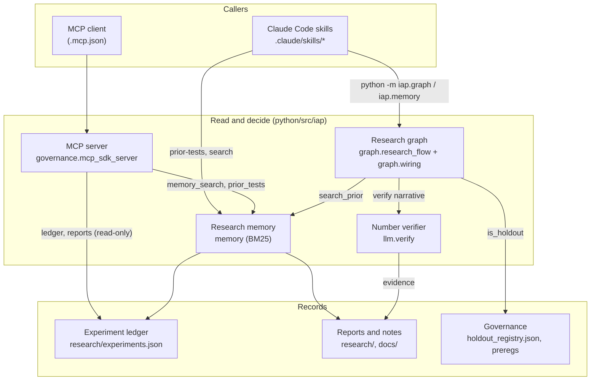

# The AI stack on one page

How the research memory, the research graph, the MCP server, the number verifier and the
Claude Code skills fit together, what each one guarantees, which test or eval measures it,
and what is not there. Every number below is copied from the committed result file named
beside it.

The rule behind all of it: code computes every number and every verdict; a language model,
when one is used, reads, drafts and cites. Nothing here calls a model API or the network.

## How the pieces fit

The graph's five outside steps are injected callables. [`iap.graph.wiring`](../python/src/iap/graph/wiring.py)
backs three of them with existing code: `search_prior` with the memory's prior-tests lookup,
`is_holdout` with the holdout registry, and `verify` with the verifier's number rules. The
in-sample runner and the narrative writer stay injected; the defaults are a stub runner that
returns fixed numbers and a writer that copies facts into one sentence.

## What each piece guarantees, and what measures it

| Piece | Guarantee | Measured by |
|---|---|---|
| Research memory ([RESEARCH_MEMORY.md](RESEARCH_MEMORY.md)) | Deterministic lexical retrieval; every hit cites file and line; snippets returned as untrusted | `python -m iap.memory eval --check`; `python/tests/test_research_memory.py` |
| Research graph ([RESEARCH_GRAPH.md](RESEARCH_GRAPH.md)) | Validated transitions, hash-chained checkpoints, a human approval stop before any run | `python/tests/test_research_graph.py` |
| Wiring: same test | A prior hit stops the flow only when one ledger entry has the same alpha id, exact horizon and universe (by name, symbol set, or the dataset it ran on); text similarity never does | `test_same_test_rule`, `test_same_test_judges_an_entry_by_the_dataset_it_ran_on`, `test_the_rule_fires_on_the_committed_ledger`, `test_duplicate_hypothesis_stops_at_prior_art`, `test_text_similarity_alone_is_not_a_duplicate` in `python/tests/test_graph_wiring.py` |
| Wiring: holdout | A dataset the registry does not hold as `in_sample` is refused, an unknown one included; a missing registry fails closed | `test_unknown_dataset_is_refused`, `test_registry_predicate_on_the_committed_registry`, `test_registry_predicate_fails_closed_without_registry` |
| Wiring: narrative | Writer text stands only if every number matches the run's facts and the verdict is named; otherwise the code-written text is used | `test_narrative_verifier`, `test_wrong_number_falls_back_to_code_text` |
| Number verifier ([AGENT_EVALS.md](AGENT_EVALS.md)) | Exact-decimal matching of every written number against cited evidence | `python -m iap.llm.verifier_eval --check` |
| Untrusted text and tool allowlist ([AGENT_EVALS.md](AGENT_EVALS.md)) | Injected text is flagged by pattern (weak); off-allowlist calls are refused (structural) | `python -m iap.llm.injection_eval --check` |
| MCP server ([MCP_SERVER.md](MCP_SERVER.md)) | Read-only tools with typed, bounded inputs; no write, subprocess or network path in the module; memory tools capped at 20 hits and 500-character queries | `python/tests/test_mcp_sdk_server.py` (end-to-end tests skip without the optional `mcp` extra) |
| Skills ([.claude/skills/](../.claude/skills/)) | Each states its guardrails; every command it names exists | `python/tests/test_skills.py` |

### Skills

| Skill | What it does |
|---|---|
| `prior-tests-check` | Looks for the same test in the ledger before any new look; stops on a duplicate |
| `research-flow` | Runs the wired graph to the approval stop, shows the unsigned draft, resumes on the person's decision |
| `triage-report` | States a report's stored verdict with file and line citations, then runs `python -m iap.graph verify-text` on the summary |
| `itch-day-bars` | Builds one in-sample ITCH day of bars with `tools/itch_bars_chain.py` (WSL build, approval flag); refuses sessions dated 2025 or later |
| `agent-evals` | Runs the three offline eval gates and reads their result files |

All five forbid signing, registration, a holdout read, and any number not copied from an
artefact.

## Measured numbers

Research memory, from [research/memory/eval_result.json](../research/memory/eval_result.json):

| Measure | Value |
|---|---|
| questions | 43 |
| chunks indexed | 3302 |
| recall at 1 | 0.9302 |
| recall at 5 | 0.9767 (floor 0.93) |
| recall at 10 | 0.9767 |
| MRR | 0.9496 |

Number verifier, from [research/agents/evals/verifier_golden_result.json](../research/agents/evals/verifier_golden_result.json):

| Set | False accept | False reject |
|---|---|---|
| Golden (146 cases) | 0 / 69, Wilson 95% [0.0, 0.052737] | 0 / 77, Wilson 95% [0.0, 0.047518] |
| Held-out (55 cases, `heldout` key) | 0 / 29, Wilson 95% [0.0, 0.11697] | 0 / 26, Wilson 95% [0.0, 0.128729] |

Injection suite, from [research/agents/evals/injection_result.json](../research/agents/evals/injection_result.json):

| Layer | Value |
|---|---|
| Pattern flag, detection | 16 / 61, Wilson 95% [0.168388, 0.384367] |
| Pattern flag, false positives | 5 / 18, Wilson 95% [0.124998, 0.508727] |
| Structural: off-allowlist calls executed | 0 of 1191 attempted (1191 refused) |

The pattern flag misses most attacks; the structural layer is the one that holds. The
narrative check in the wiring reuses the verifier's number reader, so the verifier's
measured rates are the best available estimate for it, but the narrative check itself has
only the unit cases in `test_narrative_verifier`, not a labelled eval set.

## What is not there

- **No live model evals.** Under the zero-spend rule no model API is called, so nothing
  measures how often a real model's narrative passes the verifier or how a real model
  behaves under injection. Every number above comes from fixed, hand-labelled files.
- **Lexical retrieval only.** The memory is BM25 over words. It does not match synonyms or
  paraphrases, and it cannot tell that two differently worded entries are the same test.
- **The same-test rule reaches only part of the ledger.** No entry of
  `research/experiments.json` records both a horizon and a symbol list, so the rule judges
  an entry by the dataset it ran on (`dataset_version`, resolved through
  `research/data_manifest.json`). Counted on 2026-11-18: of 640 entries, 205 record a
  horizon and 158 of those a dataset version, so 158 can stop the flow as a duplicate. A
  dataset version that is not in the manifest (older synthetic datasets) matches only when
  the hypothesis names that version itself. The 435 entries with no horizon in their config
  (execution studies, adaptive deployments, screens) never count. `python -m iap.graph run`
  prints every entry with the same alpha and horizon on another or an unknown universe as
  `check by hand`, and the person decides at the approval step.
- **The runner is a stub.** `python -m iap.graph run` returns fixed numbers unless a runner
  is given with `--runner module:function`; those numbers are not results.
- **Approval is not authenticated.** `--by` is a label, and an approved draft is not a
  pre-registration.
- **LangGraph adapter untested against a real install.** `iap.graph.langgraph_adapter`
  translates nodes and edges only and has never run against the `langgraph` package.
- **MCP end-to-end tests need the optional extra.** CI's lock does not carry `mcp`, so the
  stdio test skips there; the source scan and the memory-tool bounds run everywhere.
