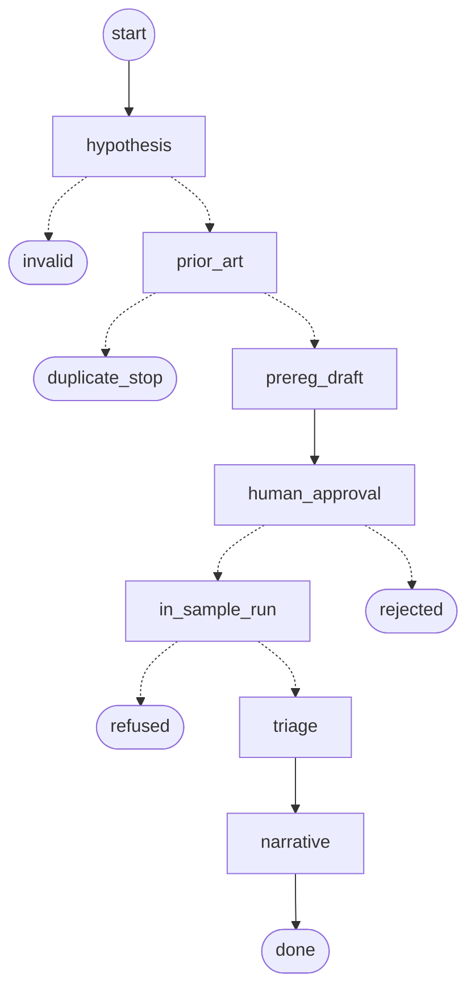

# Research graph

The research workflow is one explicit state graph, written in-house in
`python/src/iap/graph/` and tested in CI by `python/tests/test_research_graph.py`.

## The idea

A research step is a named function that reads the current state and returns
the fields it changes. Arrows between steps are either fixed or chosen by a
small router function from a declared list. The engine runs one step at a
time, checks the new state, writes it to disk with a hash of the previous
write, and stops when it reaches an end node or a step that needs a person.

## The flow

Generated from the graph definition by `python -m iap.graph diagram`; a test
fails if this block and the definition drift apart. Rounded boxes are end
nodes; dashed arrows are router choices.



| Node | What it does |
|---|---|
| `hypothesis` | Validates the record: `alpha_id`, `horizon` (one of `500ms 1s 5s 10s 30s 1m 5m 15m 30m 60m 1d`, `HORIZONS` in `research_flow.py`), `universe` (name and a non-empty list of datasets), `expected_sign` (1 or -1), `mechanism` (at least 20 characters). Errors route to `invalid`. |
| `prior_art` | Calls the injected `search_prior(hypothesis)`. A hit with `same_test: true` routes to `duplicate_stop`. |
| `prereg_draft` | Builds an unsigned draft dict in the shape of `iap.governance.prereg_gate` (`prereg_id` = first 16 hex of `digest({alpha, horizon})`, `analysis_identity` with data versions, family, metrics, thresholds). Nothing is signed or written to the blackboard. |
| `human_approval` | Returns `Interrupt`. The run stops with status `waiting`; `resume(..., decision={"approved": bool, ...})` continues. A rejection routes to `rejected`. |
| `in_sample_run` | Refuses (route to `refused`) if the injected `is_holdout(name)` flags any dataset; otherwise calls the injected runner. |
| `triage` | Code computes the verdict: `insufficient_data` if sessions < `min_sessions`, else `wrong_sign` if t has the wrong sign, else `pass` if \|t\| >= `min_abs_t`, else `fail`. |
| `narrative` | Calls the injected `write(facts)`; the text is kept only if the injected `verify(text, facts)` returns `True`. Otherwise, or if either raises, a code-written sentence is used. |

## Formal statement

- **State.** A frozen dataclass whose fields hold JSON values
  (`ResearchState`: `hypothesis`, `errors`, `prior_hits`, `duplicate_of`,
  `draft`, `decision`, `run`, `refused`, `verdict`, `narrative`,
  `narrative_source`, `outcome`). After every node the update is merged,
  deep-copied through canonical JSON, and the schema's `check()` runs.
- **Build-time validation** (`Graph.__init__`): unknown entry, unknown edge
  source or target, a router with no or unknown targets, a node with both a
  static and a conditional edge, a non-terminal without an outgoing edge, a
  terminal with one, no terminal, or a node unreachable from the entry is a
  `GraphError`. A router that returns a name outside its declared set is a
  `GraphError` at run time.
- **Event log.** One `Event` per node: step, node, sha256 of the input
  state, sha256 of the output state (or of the interrupt), duration from the
  injected clock, outcome (`ok`, `interrupt`, `terminal`), next node.
- **Checkpoints.** `run_dir/ckpt-NNNNNN.json` = `{"record": R, "sha256":
  sha256(canonical(R))}`; `R.seq` counts from 0 with no gap and
  `R.prev_sha256` is the previous file's hash (64 zeros first). `R` holds
  the graph fingerprint, status (`running`, `waiting`, `done`), the next
  node, the state, the event, what is awaited and the recorded decision.
- **Resume.** `resume(run_dir, graph, decision=...)` verifies the whole
  chain, refuses a different graph fingerprint, refuses a finished run,
  requires a decision exactly when the run is waiting, and continues from
  the last checkpoint.

## Worked example

```powershell
$env:PYTHONPATH = "python/src"
python -m iap.graph demo --out runs/demo
python -m iap.graph resume runs/demo --approve
```

The first command runs `hypothesis`, `prior_art`, `prereg_draft` and stops
at `human_approval` (five checkpoints, 0 to 4, the last one `waiting`). The second writes
the decision as checkpoint 5, runs `human_approval` again, then
`in_sample_run` (stub: t = 2.40 over 20 sessions), `triage` (2.40 >= 2.00
and 20 >= 10, so `pass`), `narrative` and `done`. With `--reject` the
run ends at `rejected` and the runner is never called.

## Guarantees and their tests

| Guarantee | Test |
|---|---|
| Invalid graphs are refused at build time | `test_build_time_validation`, `test_unfrozen_schema_refused` |
| Every transition is validated | `test_state_validation_on_every_transition` |
| A router cannot leave its declared set | `test_router_returning_undeclared_target_is_an_error` |
| Runs are bounded | `test_step_limit_on_a_cycle` |
| Same inputs give byte-identical checkpoints | `test_deterministic_replay_gives_identical_checkpoints` |
| Interrupt and resume, both ways | `test_checkpoint_chain_and_resume`, `test_flow_approved_runs_to_done`, `test_flow_rejected` |
| A stopped run continues to the same result | `test_resume_after_a_stop_between_nodes` |
| Tampered, re-chained, gapped or unreadable chains are refused | `test_tampered_checkpoint_is_refused`, `test_rechained_checkpoint_is_refused`, `test_gap_unreadable_and_empty_chains_are_refused` |
| Duplicate tests stop before a draft | `test_duplicate_stop_route` |
| Holdout data is never run | `test_holdout_dataset_is_refused_and_runner_not_called` |
| Unverified model text is replaced | `test_narrative_falls_back_when_verification_fails` |
| Nothing is written outside the run directory | `test_nothing_is_written_outside_the_run_dir` |
| LangGraph is optional and never imported by default | `test_adapter_import_does_not_import_langgraph`, `test_adapter_missing_dependency_error` |
| The CLI works end to end | `test_cli_demo_and_resume_end_to_end`, `test_cli_reject_and_diagram` |

## What it does not do

- It does not call a model or the network. `write`, `verify`,
  `search_prior`, `run_in_sample` and `is_holdout` are injected; the demo
  uses stubs. `iap.graph.wiring` backs `search_prior`, `is_holdout` and
  `verify` with the memory, the holdout registry and the number verifier
  (`python -m iap.graph run`); the runner and writer stay injected. See
  [AI_STACK.md](AI_STACK.md).
- It does not pre-register. The draft is unsigned and stays in the state;
  approving it here is not `WriteBroker.preregister` or a sign-off under
  `iap.governance.workflow`.
- The hash chain detects edits, not a rewrite of the whole chain by someone
  with write access to the run directory; nothing is signed or anchored.
- The `decision` is not authenticated: `--by` is a label.
- The LangGraph adapter (`iap.graph.langgraph_adapter`, needs the optional
  `langgraph` package) translates nodes and edges only; checkpoints and
  interrupts are not carried over, and it is not tested against a real
  LangGraph install.
