# Intraday Alpha Platform in three minutes

For a newcomer: a hiring manager, or a quant who has never seen the repository.
Every number on this page is copied from a committed document and the source
is named beside it in an HTML comment; the platform numbers are re-derived
from their artefacts by `tests/harness/check_headline_numbers.py` on every
CI run. Nothing here is a claim of profitability. The long form is
[README.md](../README.md); the full history is
[docs/README_HISTORY.md](README_HISTORY.md).

## What it is

A reproducible, event-driven research-to-production trading platform:
market data, order-book reconstruction, a feature factory, microstructure
alphas, validation with a multiple-testing ledger, portfolio construction,
a fail-closed risk engine, execution algorithms and a simulator, smart order
routing, TCA, a decision trace and a gated promotion lifecycle. It is
deliberately polyglot: Python defines the semantics and is the reference
implementation, C++ owns the latency-critical path, Rust the hard risk
engine and infrastructure, and golden tests prove the three agree byte for
byte (the Java platform layer is archived and frozen at v1.14.0). One
command, `python -m iap.mvp run`, runs the whole loop on one instrument,
fully traced, and reproduces its trace digest when run twice or replayed
from its capture. The connecting principle: **no strategy is
production-ready because of backtest Sharpe alone**, and every result,
negative ones first, is written down with the artefact that produced it.
<!-- source: README.md, opening paragraphs and "What this is, and what it is not" -->

## What is proven, and what is not

**Proven (pre-registered, one look, unseen data).**

- Two microstructure signals predict on sessions nobody had seen. The
  owner-signed confirmatory pre-registration R7-CONFIRM-1 ran once on 7
  unseen Nasdaq ITCH holdout sessions (AAPL, MSFT, QQQ): EQ10 @1s holdout
  IC +0.0838, HAC t 13.66; EQ05 @1s IC +0.0409, HAC t 13.20; threshold
  4.432; 7 of 7 sessions positive for both. Verdict: **both confirmed**
  (v1.15.0, 2026-10-13).
  <!-- source: docs/research/R7_RESULTS.md, "Verdicts" table (holdout IC, HAC t, threshold 4.432, sessions > 0) -->
- An earlier out-of-time holdout (v1.8.0): six hypotheses pre-registered
  and pushed before any 2026 feature existed; 4 of 4 confirmatory signals
  confirmed on 2026-05-15 and 2026-05-18, both controls behaved as
  registered, no run traded at 1x costs.
  <!-- source: README.md at v1.16.0 ("Out-of-time holdout (v1.8.0)"), now docs/README_HISTORY.md §1; docs/index.html "Out-of-time holdout" line -->
- The engineering holds: three independent implementations of one pinned
  semantics, held identical by golden tests, and a deterministic loop whose
  run-twice and replay-from-capture digests match (the parity table below).

**Not proven: monetisation. The negative results, stated plainly.**

- **Predictive is not tradable (v1.15).** At the primary 1x cost the net
  P&L of both confirmed signals is 0 (gross, cost, net, Sharpe and drawdown
  all 0.0 bp): the registered verdict is IC-only and says nothing about
  monetisation.
  <!-- source: docs/research/R7_RESULTS.md, "Net P&L (descriptive only)" -->
  The full loop on a real ITCH day (2019-10-18, AAPL/MSFT/QQQ) earned
  +$801 gross and lost $9,226 net at about 70,000 parent orders.
  <!-- source: README.md "Current status" (v1.15.0 paragraph), citing docs/research/MVP_REAL_20191018.md -->
- **Taker: no-go (v1.16, P0-6).** EQ10 / EQ05 as a cost-aware taker on 10
  in-sample sessions, a grid of 480 cells: **zero trades in every cell**.
  The largest expected return was about 0.1-0.2 bp against a median
  round-trip cost of about 0.8-1.2 bp.
  <!-- source: docs/release/v1.16.0_RELEASE_NOTES.md, "P0-6 in-sample monetisation study" -->
- **Capacity: none (v1.16, item 7).** **0 of 45 cells** have a break-even
  size above zero; the best tail edge is 0.92 bp (EQ10, AAPL, 1 min, top
  0.1% of signals) against a round-trip cost of 0.8-2.4 bp.
  <!-- source: docs/release/v1.16.0_RELEASE_NOTES.md, "Item 7 taker capacity curve" -->
- **Quoting v2: no edge (v1.16).** Two-sided skewed quoting, registered and
  signed, run in-sample on 6 test sessions: every cell loses $5.0-6.9k per
  session with Bonferroni intervals below zero, and adverse selection is
  about 4x the spread captured. Skewing with EQ01 or EQ05 cuts the loss by
  about $750-920 per session against the no-skew control, so the signals
  are useful as an execution input, not as a strategy.
  <!-- source: docs/release/v1.16.0_RELEASE_NOTES.md, "M5 two-sided quoting study v2" -->
- **AI4 DeepLOB: closed (v1.16, item 10).** In-sample failure: net
  -0.69 bp per trade (gross +0.27 bp against a 0.97 bp cost); the linear
  baseline nets -0.74 bp and GBM -0.68 bp; the accept rule fails on all
  three symbols. No holdout look was spent, by owner decision.
  <!-- source: docs/release/v1.16.0_RELEASE_NOTES.md, "AI4 DeepLOB (item 10)" -->
- **Bundled synthetic data: 0 PROMOTE of 24 alphas.** 18 never forecast a
  move larger than their round-trip cost and make no trade; the 6 that
  trade lose. 23 alphas sit at CANDIDATE and none advances, because every
  one fails the net-P&L-after-costs gate.
  <!-- source: README.md "Headline numbers" (Promotion verdicts, Lifecycle registry rows) and docs/index.html "Results so far" -->

**Released: v1.18.0 (2026-10-24), a measurement instrument and recorded negative results. No signal is promoted and no edge is claimed.**
- **The known-null calibration failed** (null v3, run 2026-10-23): A0 conditional rejection 79 and 80 of 1,854 (about 4.3 %) in two cells against a 2.5 % target; the outside reviewer rejected the method as the F3 gate, so no real-data error-rate control is claimed.
  <!-- source: research/v118/known_null_v3_RESULT.md; docs/release/REVIEWER_CLOSEOUT_2026-10-23.md -->
- **Every signed run is negative or underpowered.** B8 v2: all 6 comparisons underpowered, none better than pinned Nasdaq (3 evaluation sessions). REL-05: AAPL and MSFT inconclusive, QQQ supports. REL-08 (one-session screen, 7 variants): all underpowered, with defects found afterwards. REL-09: underpowered. REL-10: one taker cell rejected (`hid_imb` 1 min AAPL loses money), the rest underpowered. REL-08c was dropped.
  <!-- source: docs/release/v1.18.0_RELEASE_NOTES.md, "Negative and inconclusive results, first" -->
- **The fill model is validated at Level 1 (deterministic replay) only, not at Level 2**; there is no latency edge. No real orders or fills exist (decision D4(a)).
  <!-- source: docs/SIM_TO_REAL.md; docs/release/v1.18.0_RELEASE_NOTES.md -->
- **Built:** signed pre-declarations that bind script, commit, data and thresholds, a fail-closed holdout registry, one real-data ledger family, execution benchmark v2 metrics, a capped child simulator with an invariant suite, monitoring with an UNKNOWN state, factor risk and portfolio limits with a kill switch, and a paper-path order manager (60-minute and 6-hour soaks PASS on a synthetic feed, not a live venue).
  <!-- source: CHANGELOG.md "## v1.18.0"; research/v118/rel18_soak_6h/ -->
- **Open gates, accepted open for this tag:** F3, F7 (no independent rerun of the B8 v2 JSON), the reviewer's full findings memo; F5 partly met.
  <!-- source: docs/release/v1.18.0_RELEASE_NOTES.md, "Open gates"; docs/release/FOUNDATION_COMPLETE_v1.18.md -->

**Released: v1.17.1 (2026-10-17), a patch release; v1.17.0 released 2026-10-16.**
- **B7 closed** on its negative in-sample result; **B8 negative on 2 overlap days** (`sor` +5.1 ± 1.3 bps, `sor_sweep` +3.8 ± 2.1; provisional); pre-declared six-day out-of-sample run also negative (`sor` +2.2 / +1.1, `sor_sweep` +0.6 / +1.2 bps; AAPL / MSFT; no interval excludes zero); 6 of 9 IEX days recorded; #211 fixes the missing manifest, SBOMs and digest pins.
  <!-- source: CHANGELOG.md "## v1.17.1"; research/execution/b8/REPORT_sweep.md -->

**Released: v1.17.0 (2026-10-16), execution quality and breadth.**
- **Breadth screen: 0 pass / 22 fail / 1 not screened** of 23 candidates;
  net IC negative in every screened row (round trip about 1.90-2.02 bps).
  <!-- source: research/breadth/screen/SCREEN_multi7.md -->
- **Breadth book (C8): registered under option (a), no confirmatory look**;
  the screen refused every candidate and the holdout is unread.
  <!-- source: research/preregs/breadth_book_prereg.json -->
- **Dark venue (B10): modelled, not measured** (no free dark-pool data).
- **IEX second venue (as of v1.17.0):** day 1 (2025-11-28) processed, TOPS oracle 0
  mismatches for AAPL, MSFT and QQQ; 6 of the 9 overlap days were recorded by v1.17.1.
  <!-- source: docs/research/IEX_OVERLAP_SET.md -->
- **Known gap:** v1.17.0 ships no release manifest, no lock-file SBOMs and
  no digest-pinned k8s manifests; fixed by PR #211, ships with v1.17.1.
<!-- source: CHANGELOG.md "## v1.17.0"; docs/release/v1.17.0_RELEASE_NOTES.md -->

**Next (not part of v1.18.0):** this documentation pass, a diagnostic review of the failed known-null method, a REL-08 rule v2 with a multi-session screen, and v1.19 planning (nothing planned or approved yet). See [docs/ROADMAP.md](ROADMAP.md) §3.14.

## Numbers a CI check re-derives

`python tests/harness/check_headline_numbers.py` recomputes each platform
number below from the artefact in the third column and fails CI when a
document disagrees (research-ledger numbers move with every rerun and are
reported as stale rather than failing).

| what | number | artefact |
|---|---|---|
| Cross-language parity (CI counts, main CI run 40015853764, 2026-10-23, v1.18.0) | tests python 4062 / cpp 333 / rust 376; golden 217 / 74 / 75; integration 35, replay 6 | `tests/harness/run_all.sh` table in README.md |
| MVP golden run (`python -m iap.mvp run`, seed 12345) | 15,805 events · 800 decisions · 231 parent orders · 163 fills · P&L −82.84 USD · digest `a7f1ee60…` | `tests/golden/expected_mvp.json` |
| Registered features | 205 in 10 families | `data/reference/feature_registry.json` |
| Flagship alphas | 24 (EQ01-EQ12, FX01-FX12); verdicts 0 PROMOTE / 12 ITERATE / 12 REJECT | `research/alpha_reports/REPORT.md` |
| Promotion lifecycle | 7 states · 17 pinned edges · 20 gates; 23 alphas at CANDIDATE, 0 beyond | `research/alpha_registry.json`, `tests/golden/expected_lifecycle.json` |
| Contracts | 17 JSON Schemas · 22 typed Python contracts · 18 runtime-checkable Protocols | `schemas/`, `python/src/iap/contracts/` |
| Experiments ledger | real data: 256 configurations holding 1,132 of the looks (per-dataset real ledgers and the B7/B8 execution studies merged in by the v1.18 REL-02 migration); synthetic data: 384 configurations holding 5,694 of the looks (excluded from the real-data N); total 6,826 recorded looks over 640 distinct configurations; expected max \|t\| 4.202; Bonferroni per-test \|t\| ≥ 4.484; a lower bound, not a complete historical denominator (known gaps: `research/v118/LEDGER_INVENTORY.md`) | `research/experiments.json`, `research/v118/LEDGER_INVENTORY.md` |
| C++ tick-to-trade (shared CI runner AMD EPYC 7763, no pinning, `steady_clock`; not colocation) | p50 1,279 ns · p99 2,559 ns · p99.9 11,263 ns, in-process, decoded frame to order intent | `benchmarks/results_tick_to_trade.md` |
| Rust feature engine from Python (CI runner ubuntu-24.04; not colocation) | about 790,000 events/s against about 5,250 through the Python reference on the 45 native slots: 150x, not a pipeline speed-up | `rust-pyo3` CI job summary, API_FEATURES.md §7.1 |
<!-- source: README.md "Headline numbers" table and "Cross-language parity" table (every row); the same figures appear in docs/index.html "Measured, not claimed" -->

**No latency edge; benchmarks are not colocation numbers.** The two speed rows above are in-process
figures from a shared CI runner (no network, NIC, kernel bypass or venue round trip). The signals are
execution inputs, not strategies (B7, the net-of-cost screen and the v1.16 monetisation study found no
edge).

## Architecture, one diagram

The end-to-end pipeline as realised (spec §4). The block below is a verbatim
copy of `docs/diagrams/pipeline.mmd`; the other 40 diagrams are in
[docs/DIAGRAMS.md](DIAGRAMS.md).

```mermaid
flowchart TD
    subgraph GEN["Synthetic venues — seeded generator (SplitMix64, seed 20260829)"]
        V1["Equity MBO streams<br/>11 instruments @ venue XV1<br/>regimes, self-exciting flow, halt, auctions"]
        V2["FX QUOTE+TRADE streams<br/>8 G10 pairs @ LP1/LP2/PRI<br/>venue latency profiles"]
    end
    V1 --> RAW["data/raw/*.jsonl<br/>immutable raw feed files"]
    V2 --> RAW
    RAW --> NORM["Normalization + sequence validation<br/>python iap.marketdata.normalize<br/>gaps / dups / late / resets / ts-regressions / invalid counted -> qc_report.json"]
    NORM --> CANON["Canonical event stream<br/>JSONL + IAP1 v2 binary (72-byte LE records + CRC-32 trailer)<br/>+ Parquet research dataset — schemas x-version 1"]
    CANON --> BOOK["Order-book reconstruction<br/>Python ref / C++ / Rust / Java<br/>MBO FIFO, status-gated matching, synthetic ids, dup-drop,<br/>gap->stale, reorder window, sequence resets, SNAPSHOT recovery"]
    BOOK --> FEAT["Feature engine<br/>205-feature registry (hash = feature_version)<br/>native 40 in C++/Rust/Java — validity bitset, NaN never valid"]
    FEAT --> LBL["Event-time labels (Python-owned)<br/>11 horizons, mid-to-mid + cost-adjusted<br/>at-or-before rule, no lookahead"]
    FEAT --> ALPHA["Alpha ensemble<br/>24 flagship alphas (EQ01-FX12)<br/>linear_z_v1 scoring; 6 golden alphas ported"]
    ALPHA --> PORT["Portfolio construction<br/>PGD + prox, 7 constraint families, EWMA cov<br/>Python reference, Java production service"]
    PORT --> RISK["Hard risk engine — FAIL-CLOSED<br/>Rust reference, Java orchestration, Python reference port<br/>limits, throttles, gap/stale gates, kill switches"]
    RISK --> EXEC["Execution algos + event-driven simulator<br/>VWAP / TWAP / POV / IS; deterministic queue model<br/>C++ reference, Java + Python ports"]
    EXEC --> SOR["SOR / venue adapters<br/>cpp/sor, rust venue protocol + sim"]
    SOR --> FILLS["Executions (fills, fees, rebates, impact)"]
    FILLS --> TCA["TCA + attribution<br/>Perold IS = delay + trading + opportunity (exact)<br/>Python reference, Java service"]
    TCA --> TRACE["Decision trace — one DecisionTrace per decision<br/>signal · portfolio · risk · orders · routing · fills · TCA · attribution<br/>canonical JSONL + stream digest + SQLite index (iap.store); explain()"]
    LBL --> RESEARCH
    TRACE --> RESEARCH["Research feedback / alpha factory<br/>ExperimentRunner -> research/experiments/ID/ + the ledger (6,826 looks / 640 configs as of the v1.18 REL-02 migration, research/experiments.json)<br/>REPORT.md, ML_REPORT.md, model manifests"]
    RESEARCH --> LIFE["Alpha promotion lifecycle (iap.lifecycle)<br/>RESEARCH -> CANDIDATE -> VALIDATING -> PAPER -> ACTIVE <-> WATCH -> RETIRED<br/>20 gates, 17 edges; bundled data: 23 CANDIDATE / 0 beyond"]
    LIFE -. "gated, ledgered transitions<br/>(research/alpha_registry.json)" .-> ALPHA
```



## Ten-minute quick start

Prerequisites: Python 3.11 (+ pyarrow); g++ 13 / CMake / GoogleTest and
Rust 1.99.0 only for the C++ and Rust suites
([docs/BUILD_NOTES.md](BUILD_NOTES.md)). The commands are the README's
quick start, steps 1-4 and 8.
<!-- source: README.md "Quick start"; COOKBOOK.md recipe 1 (the dataset regeneration) -->

```bash
# 1. Generate the seeded synthetic dataset (raw → normalized → Parquet + QC)
cd python && PYTHONPATH=src python3 -m iap.marketdata && cd ..

# 2. Run each language's test suite
cd python && PYTHONPATH=src python3 -m pytest -q && cd ..
cd cpp    && bash build.sh && ctest --test-dir build --output-on-failure && cd ..
cd rust   && cargo test && cd ..

# 3. Or all three + the repo-level integration/replay suites + the parity table
bash tests/harness/run_all.sh              # add --golden-only for the fast parity check

# 4. Run the whole platform loop on one instrument, fully traced (docs/MVP.md; under a minute)
cd python && PYTHONPATH=src python3 -m iap.mvp run                    # -> ../data/mvp/<run_id>/
PYTHONPATH=src python3 -m iap.mvp verify                              # run twice, identical bytes
PYTHONPATH=src python3 -m iap.mvp replay --run ../data/mvp/<run_id>   # same digest from the capture
PYTHONPATH=src python3 -m iap.mvp explain --run ../data/mvp/<run_id> 5   # one order's chain
cd ..

# 8. Validate the deployment the way CI does, and every headline number
python3 tests/harness/check_deployment.py
python3 tests/harness/check_headline_numbers.py   # every number in the README vs its artefact
```

Identical seed ⇒ bit-identical output files (seed 20260829: 309,598 events
in, 308,975 out, from the QC report).
<!-- source: COOKBOOK.md recipe 1, "Expect (seed 20260829)" -->

## Where to go next

- [README.md](../README.md): the current status, the headline-numbers table,
  the parity table and the documentation index.
- [docs/HOW_IT_WORKS.md](HOW_IT_WORKS.md) and [LEARN.md](../LEARN.md): how the
  quant, algo and AI sides work, and the case studies behind each negative
  result.
- [COOKBOOK.md](../COOKBOOK.md): 140 task-oriented recipes with runnable
  commands.
- [docs/release/v1.18.0_RELEASE_NOTES.md](release/v1.18.0_RELEASE_NOTES.md),
  [docs/release/v1.16.0_RELEASE_NOTES.md](release/v1.16.0_RELEASE_NOTES.md)
  and [docs/research/R7_RESULTS.md](research/R7_RESULTS.md): the documents
  the negative and positive results above are copied from.
- [docs/REAL_DATA.md](REAL_DATA.md): how to obtain and ingest real files
  yourself (nothing real is bundled).
- [docs/index.html](index.html): the GitHub Pages landing page.
